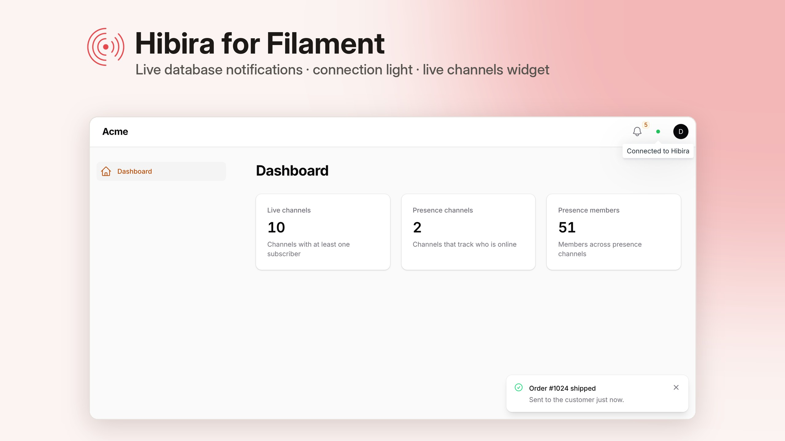
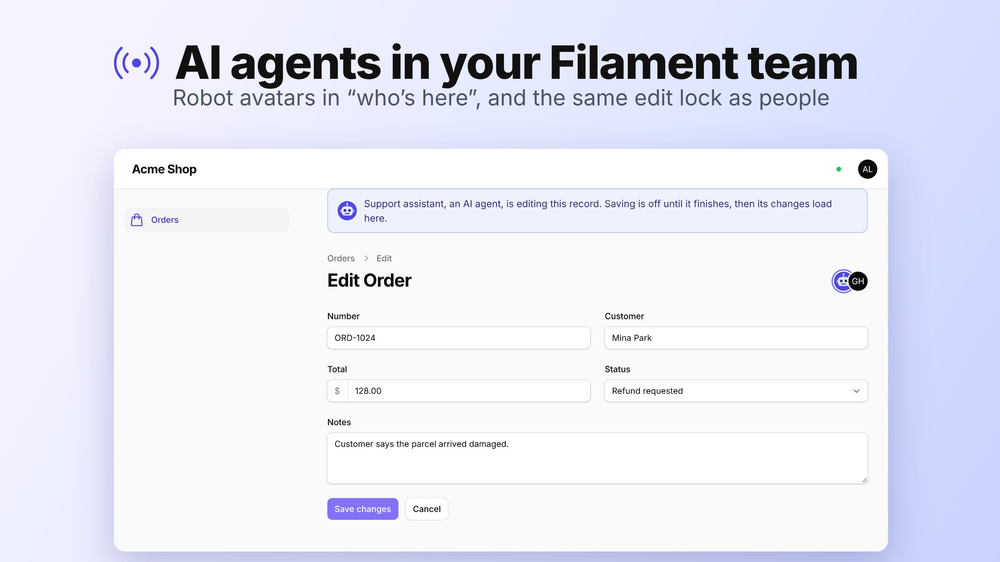
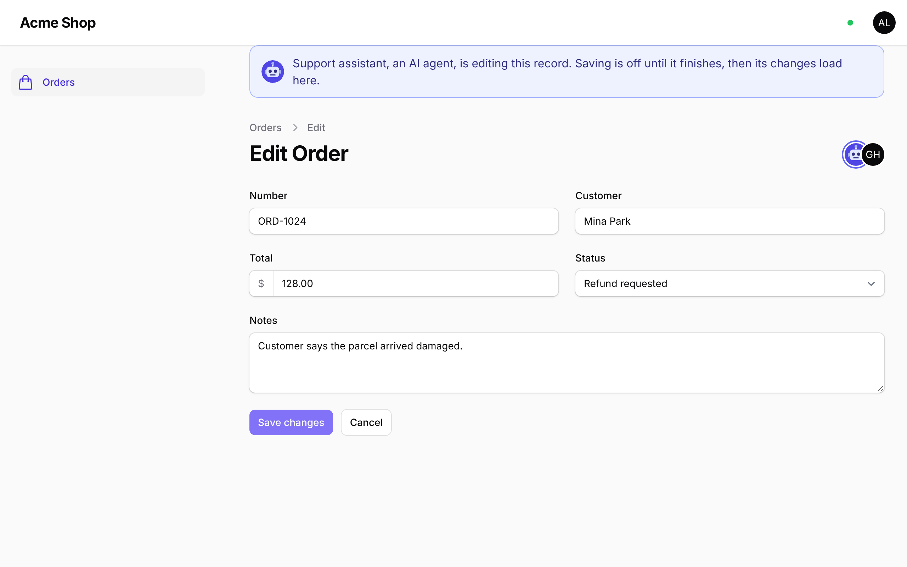
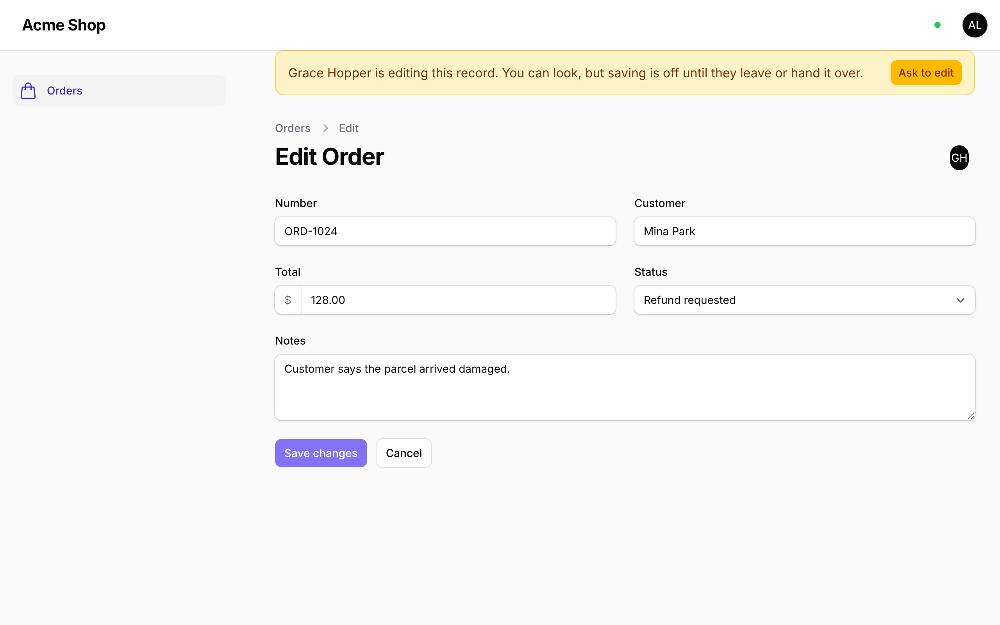
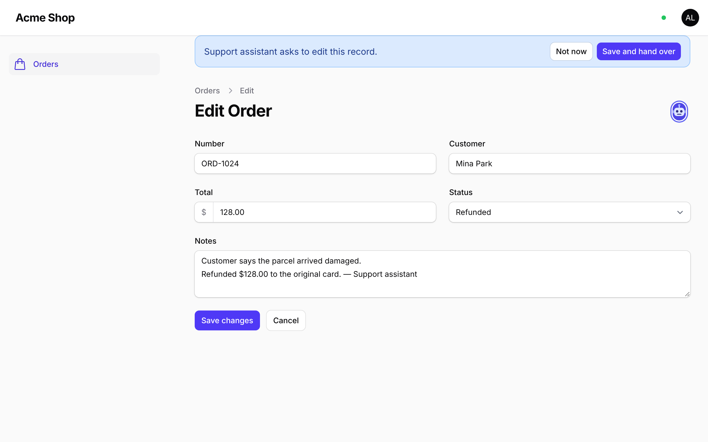

# hibira-io/filament



[](https://github.com/hibira-io/filament/actions/workflows/ci.yml)

Live notifications for [Filament](https://filamentphp.com) panels, on
[Hibira](https://hibira.io).

Filament can already talk to any Pusher-compatible WebSocket service, once
you publish `config/filament.php`, uncomment its Echo block and fill in the
host, port and key. This plugin does that for you from the same `HIBIRA_*`
settings the rest of your app uses, and adds:

- **Live database notifications.** The bell updates the moment a
  notification is sent, instead of every 30 seconds.
- **A connection light** next to the user menu, so you can see at a glance
  whether the browser is connected.
- **A live channels widget** for the dashboard: channels in use, presence
  channels and the members in them.
- **Who's here.** Avatars in the page header show who else has the same page
  open.
- **Edit locks.** One person edits a record at a time. Others see who holds
  it, can ask for it, and get it as soon as the holder hands it over or
  leaves, with no heartbeat polling and no lock table.
- **AI agents in the room.** When an AI agent edits a record, it shows up in
  the avatars with a robot face and takes the record's edit lock, just like
  a person, so nobody saves over its work and it never saves over theirs.
- **Live tables.** Resource tables refresh for everyone who has them open
  when records are saved or deleted, instead of polling.
- **Import and export progress.** A progress bar shows how many rows of an
  import or export are done, chunk by chunk.
- **Team chat.** A Chat page for the panel's users, one to one or in
  groups, with unread counts, online status and message history.

Supports Filament 3, 4 and 5. It builds on
[hibira-io/laravel](https://github.com/hibira-io/laravel), which sets up
broadcasting, push notifications and webhooks.

## Install

```sh
composer require hibira-io/filament
php artisan hibira:install
```

`hibira:install` (from hibira-io/laravel) adds the `HIBIRA_*` settings to
`.env` and sets `BROADCAST_CONNECTION=hibira`. Copy the app ID, key and
secret from your app page on [hibira.io/portal](https://hibira.io/portal)
(the free plan needs no card):

```ini
BROADCAST_CONNECTION=hibira
HIBIRA_APP_ID=your-app-id
HIBIRA_APP_KEY=your-app-key
HIBIRA_APP_SECRET=your-app-secret
HIBIRA_HOST=ws.hibira.io
```

Check them with `php artisan hibira:check`.

Then add the plugin to your panel:

```php
use Hibira\Filament\HibiraPlugin;

public function panel(Panel $panel): Panel
{
    return $panel
        // ...
        ->plugin(
            HibiraPlugin::make()
                ->databaseNotifications()
                ->channelsWidget()
        );
}
```

That's it. Filament's own JavaScript already includes Laravel Echo, so there
is nothing to build. You don't need `npm run build` for the panel, and you
don't need to publish `config/filament.php`.

Until `HIBIRA_APP_KEY` is set the plugin stays out of the way: the panel
loads without Echo and database notifications keep polling.

## Live database notifications

`->databaseNotifications()` turns on the panel's notification bell and
turns off its polling. To send a notification that shows up straight away,
pass `isEventDispatched: true` so Filament tells the browser over Hibira:

```php
use Filament\Notifications\Notification;

Notification::make()
    ->title('Order #1024 shipped')
    ->success()
    ->sendToDatabase($user, isEventDispatched: true);
```

Or send a toast that is not stored, to a user who is online now:

```php
Notification::make()
    ->title('Export ready')
    ->broadcast($user);
```

Both go out on the user's private channel, so your app needs the broadcasting
auth route and the channel authorization Laravel adds with
`php artisan install:broadcasting --without-reverb --without-node`
(Laravel 11 and later). `routes/channels.php` then contains:

```php
Broadcast::channel('App.Models.User.{id}', function ($user, $id) {
    return (int) $user->id === (int) $id;
});
```

If you'd rather keep polling as a fallback, give it an interval:

```php
HibiraPlugin::make()->databaseNotifications(polling: '60s')
```

### Panels with their own guard

Echo authorizes private channels at `/broadcasting/auth`, which uses the
`web` guard by default. If your panel signs users in with another guard,
register the broadcasting routes with that guard, and point Echo at them if
you changed the path:

```php
// bootstrap/app.php
->withBroadcasting(__DIR__.'/../routes/channels.php', [
    'middleware' => ['web', 'auth:admin'],
])
```

```php
HibiraPlugin::make()->echoOptions(['authEndpoint' => '/admin/broadcasting/auth'])
```

## Connection light

A small dot next to the user menu shows the connection: green when
connected, amber while connecting, red when the service can't be reached and
grey when disconnected. Hovering shows the state in words.

Move it or turn it off:

```php
use Filament\View\PanelsRenderHook;

HibiraPlugin::make()->connectionStatus(renderHook: PanelsRenderHook::TOPBAR_END)
HibiraPlugin::make()->connectionStatus(false)
```

## Live channels widget

`->channelsWidget()` adds `HibiraChannelsWidget` to the dashboard. It shows:

- **Live channels**: channels with at least one subscriber
- **Presence channels**: channels that track who is online
- **Presence members**: members across all presence channels (someone in two
  rooms counts twice)

It refreshes every 10 seconds through the Channels HTTP API. API calls don't
count as messages on your plan.

To place it yourself, for example on a custom page or only for some users,
leave `->channelsWidget()` off and register the class like any other widget:

```php
use Hibira\Filament\Widgets\HibiraChannelsWidget;

$panel->widgets([HibiraChannelsWidget::class]);
```

## Who's here

`->presence()` shows the avatars of everyone else on the same page, next to
the page's header actions. Each page path is its own room, so people on the
posts list don't show up on a post's edit page.

```php
HibiraPlugin::make()->presence()
```

The plugin registers the presence channels itself and lets in anyone who may
use the panel (the same `canAccessPanel()` check Filament makes). Echo joins
them through `/broadcasting/auth`, so the broadcasting routes need to be on,
as for [live notifications](#live-database-notifications). Move the avatars
with `->presence(renderHook: PanelsRenderHook::TOPBAR_END)`.

## Edit locks

Add `InteractsWithHibiraLock` to an edit page:

```php
use Filament\Resources\Pages\EditRecord;
use Hibira\Filament\Concerns\InteractsWithHibiraLock;

class EditPost extends EditRecord
{
    use InteractsWithHibiraLock;

    protected static string $resource = PostResource::class;
}
```

The first person to open a record holds its lock. Anyone else who opens it
sees who is editing, and Save is turned off for them. They can:

- **Ask to edit.** The holder gets a prompt with **Save and hand over**,
  which saves the holder's changes and passes the lock across.
- **Wait.** When the holder closes the page, the next person on it takes the
  lock within a few seconds.

Everyone on the edit page joins a presence channel for that record. When the
holder's connection drops, Hibira tells the others, and the server checks
Hibira's member list before moving the lock, so a stale lock never blocks
anyone and nothing polls. If Hibira can't be reached, the lock stays where it
is.

The holder is kept in your cache store, so use one that supports atomic
locks (`redis`, `database`, `memcached`, `dynamodb`, `file` or `array`).
Presence for locks works with or without `->presence()`.

## AI agents



Agents that change records, such as a [Laravel AI SDK](https://laravel.com/docs/ai)
tool, a support bot or an approved action from
[hibira-io/filament-approvals](https://github.com/hibira-io/filament-approvals),
can join a record's page the same way a person does. Wrap the change in
`Agent::edit()`:

```php
use Hibira\Filament\Agents\Agent;

Agent::make('support-assistant')
    ->name('Support assistant')
    ->edit($order, function () use ($order) {
        $order->update(['status' => 'refunded']);
    });
```

While the callback runs:

- **The agent shows up in "Who's here"** on the record's view and edit pages,
  with a robot avatar and an "AI agent" label. Pass `->avatar($url)` for your
  own image.
- **It holds the edit lock.** People on the edit page see a banner saying the
  agent is editing, and their Save button is off.
- **It lets go when done**, even if the callback throws. The next person on
  the page takes the lock and their form reloads with the agent's changes.

| The agent is editing | It's done, its changes are loaded |
| --- | --- |
|  |  |

The agent follows the lock rules too. If a person is editing the record,
`edit()` throws `RecordLockedException` without running the callback. Pass
`wait:` to ask them for it instead: they get the usual **Save and hand over**
prompt, and the agent waits up to that many seconds for the record.



In a Laravel AI SDK tool, tell the model when the record is busy so it can
say so or try later:

```php
use Hibira\Filament\Agents\Agent;
use Hibira\Filament\Agents\RecordLockedException;
use Laravel\Ai\Contracts\Tool;
use Laravel\Ai\Tools\Request;

class RefundOrder implements Tool
{
    public function handle(Request $request): string
    {
        $order = Order::findOrFail($request['order_id']);

        try {
            return Agent::for(SupportAssistant::class)->edit($order, function () use ($order) {
                $order->refund();

                return "Order {$order->id} refunded.";
            }, wait: 20);
        } catch (RecordLockedException $e) {
            return "{$e->holder['name']} is editing this order right now. Try again later.";
        }
    }

    // description() and schema() as usual.
}
```

`Agent::for()` names the agent after a class: `SupportAssistant` becomes
"Support Assistant".

The agent appears in every panel that uses this plugin and has a resource for
the record's model, and takes the lock of each edit page that uses
`InteractsWithHibiraLock`. Limit it with `->panels('admin')`.

Agents run in a queued job or a request, not a browser, so they can't keep a
WebSocket open. They are kept in your cache store and announced to the page
with events instead. If the agent's process dies, it times out after five
minutes (`->ttl(seconds)`). For longer work, call `touch()` on the session the
callback receives, or use `start()` and `stop()` yourself:

```php
$session = Agent::make('importer')->start($record);

try {
    foreach ($rows as $row) {
        // ...
        $session->touch();
    }
} finally {
    $session->stop();
}
```

## Live tables

`->liveTables()` refreshes a resource's list page for everyone who has it
open, whenever one of its records is created, updated, deleted or restored:
in the panel, in a queued job, an API controller or a console command.

```php
HibiraPlugin::make()->liveTables()
```

Changes are collected and sent once when the request or queued job ends, so
an import of a thousand rows refreshes each open table once per chunk, not a
thousand times. Browsers wait 300 ms after the last message before
refreshing.

The plugin watches the models of the panel's resources. For pages whose
table lists another model, pass it:

```php
HibiraPlugin::make()->liveTables(models: [AuditEntry::class])
```

Only Eloquent model events are seen. After a mass update through the query
builder, mark the table yourself:

```php
Post::query()->where('draft', true)->update(['draft' => false]);

app(\Hibira\Filament\LiveTables::class)->touch(Post::class);
```

## Import and export progress

Filament runs imports and exports as queued jobs and tells you when they are
finished. `->importProgress()` also shows how far along they are: a small
card in the corner fills up as each chunk of rows is processed, and goes
away a few seconds after the last one.

```php
HibiraPlugin::make()->importProgress()
```

It works with Filament's own `ImportAction` and `ExportAction`, including
custom importers and exporters, and picks up imports that were already
running when the page loads. The card only goes to the user who started the
import.

## Team chat

`->chat()` adds a **Chat** page and a chat button with the unread count to
the top bar. Panel users can message each other one to one or start a group,
see who is online, and scroll back through earlier messages.

```php
HibiraPlugin::make()->chat()
```

Messages are stored by Hibira's Chat API, so there are no tables to migrate
and nothing to queue. The Chat API is in beta and is turned on per account:
ask us at [hibira.io](https://hibira.io) to turn it on. Until then the Chat
page says chat is unavailable.

How it fits together:

- Each browser signs in to Hibira as its panel user, through a route the
  plugin adds to the panel (`/admin/hibira/user-auth`). New messages, read
  receipts and online status arrive over that sign-in, with no channel per
  conversation.
- Anyone who may use the panel (`canAccessPanel()`) can chat. Users are
  found by `name` and `email`; pass other columns with
  `->chat(searchColumns: ['name', 'username'])`.
- Chat users are named `<panel>.<user key>`, so each panel has its own
  conversations.
- A group holds up to 50 people. Messages are up to 4,000 characters.

Hide the page from the navigation with `->chat(navigation: false)` (the top
bar button still links to it), or move the button with
`->chat(buttonRenderHook: PanelsRenderHook::TOPBAR_END)`.

Every message counts as one message per member toward your plan, like any
other event.

## Echo options

The plugin builds these Echo options from `config/hibira.php`:

| Option | From |
| --- | --- |
| `key` | `HIBIRA_APP_KEY` |
| `wsHost` | `HIBIRA_HOST` (default `ws.hibira.io`) |
| `wsPort`, `wssPort` | `HIBIRA_PORT` (default `443`) |
| `forceTLS` | `HIBIRA_SCHEME` is `https` |
| `cluster` | always `hkg`; pusher-js requires one but ignores it once `wsHost` is set |

Anything else can be added or replaced with `->echoOptions([...])`.

The settings are applied only while the panel with the plugin is being
served, so other panels keep their own `filament.broadcasting.echo` config.

## Translations

The connection light and widget come in English, Traditional Chinese,
Simplified Chinese, Japanese, Korean, Thai and Vietnamese, following the app
locale. To change the wording:

```sh
php artisan vendor:publish --tag=hibira-filament-translations
```

## Development

```sh
composer install
composer test
```

## License

[MIT](LICENSE)
